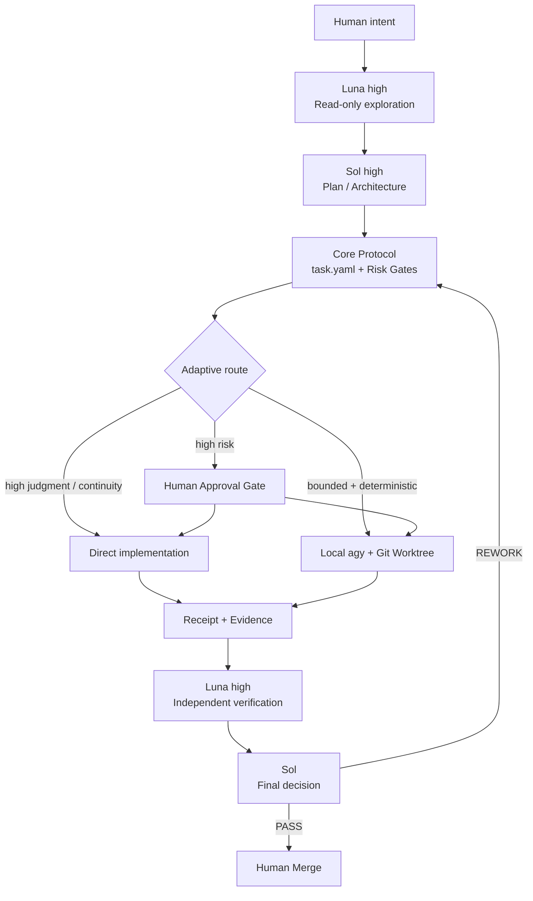

# gpt-antigravity-dev-control

[中文说明](README.zh-CN.md)

A local-first, risk-adaptive AI development control plane: **Sol high decides and
plans; Luna high explores and reviews; Antigravity / Gemini implements bounded,
mechanical tasks in Git worktrees; deterministic checks run outside the model
session; Sol makes the final acceptance decision; humans approve high-risk work
and merge**.

There is one task protocol and one primary CLI. Per-task `execution.mode` selects
direct implementation, local delegation, or approval-required delegation.

The primary deliverable is `.agents/skills/antigravity-delegate`. Copy that Skill into
another Git project and initialize only its minimal `.ai/` runtime state:

```powershell
python .agents/skills/antigravity-delegate/scripts/control.py init --repo D:\Projects\my-app
python .agents/skills/antigravity-delegate/scripts/control.py --repo D:\Projects\my-app create TASK-001 --title "Bounded change" --objective "Observable result"
```

## Quick start

```sh
python -m pip install -r .agents/skills/antigravity-delegate/scripts/requirements-local.txt
python .agents/skills/antigravity-delegate/scripts/control.py status
python .agents/skills/antigravity-delegate/scripts/control.py probe
python .agents/skills/antigravity-delegate/scripts/control.py --help
```

Create a task from `.agents/skills/antigravity-delegate/templates/task/`, then choose its route:

```yaml
execution:
  mode: delegated  # direct | delegated | approval_required
  adapter: antigravity_cli
  context_budget: compact
  report_level: summary
  max_implementation_reworks: 1
  max_infra_retries: 1
  escalation: codex_review
planning:
  work_type: mechanical
  judgment: low
  context_continuity: low
  acceptance_determinism: high
```

```sh
python .agents/skills/antigravity-delegate/scripts/control.py validate TASK-001
python .agents/skills/antigravity-delegate/scripts/control.py route TASK-001
python .agents/skills/antigravity-delegate/scripts/control.py prepare TASK-001 --approve
python .agents/skills/antigravity-delegate/scripts/control.py launch TASK-001 --approve --interactive
python .agents/skills/antigravity-delegate/scripts/control.py verify TASK-001 --approve --approval-file .ai/runtime/verify-approval.yaml
python .agents/skills/antigravity-delegate/scripts/control.py collect TASK-001
```

The older ai.py and delegate.py commands remain compatibility entry points;
new usage should use control.py.

## Use it inside Codex

The project Plus profile uses Sol high as the sole planning, architecture, and
final-acceptance authority; Luna high for bounded read-only exploration and
independent review; and local Antigravity for low-judgment, deterministic tasks.
Semantic, security, architecture, continuity-sensitive, or weakly specified work
routes to direct Codex unless a structured override is approved. Native threads are capped at two; the
combined native/agy budget is root-coordinated, not a shared runtime lock. See
[Hybrid Orchestration](.agents/skills/antigravity-delegate/references/orchestration.md).

With Python 3.11+, run `python .agents/skills/antigravity-delegate/scripts/control.py check-orchestration` to detect
project configuration drift. This is not runtime model or sandbox verification.

The repository includes a discoverable skill at
.agents/skills/antigravity-delegate. In a Codex task opened on this checkout,
invoke $antigravity-delegate. Codex then owns the planning, command execution,
receipt collection, review, and recovery flow; agy is started only as the local
implementation subprocess.

### Invocation

Invoke the Skill directly in a Codex task:

```text
Use $antigravity-delegate to complete this feature:
add email verification to the login flow and include tests.
```

To request the local Antigravity backend explicitly:

```text
Use $antigravity-delegate, delegate the implementation to Antigravity,
work in an isolated Git worktree, and return the test results and receipt path.
```

For delegated work the handoff is sequential: optional Luna exploration returns
repository evidence; Sol creates the task contract; agy implements as the only
writer and marks the receipt `IMPLEMENTED`; after agy exits, the controller runs
the exact probe/fast/final gates and Luna independently reviews the same snapshot.
Sol then decides PASS, REWORK, or BLOCKED. No agent merges automatically.

For a standalone Git project, initialize the minimal runtime state and probe the
local executable first:

```powershell
python .agents/skills/antigravity-delegate/scripts/control.py init --repo D:\Projects\my-app
Set-Location D:\Projects\my-app
python .agents/skills/antigravity-delegate/scripts/control.py probe
```

Create, validate, route, and run a bounded task:

```powershell
python .agents/skills/antigravity-delegate/scripts/control.py create TASK-001 `
  --title "Add email verification login" `
  --objective "Add verification checks and tests" `
  --risk medium `
  --mode delegated

python .agents/skills/antigravity-delegate/scripts/control.py validate TASK-001
python .agents/skills/antigravity-delegate/scripts/control.py route TASK-001
python .agents/skills/antigravity-delegate/scripts/control.py prepare TASK-001 --approve
python .agents/skills/antigravity-delegate/scripts/control.py launch TASK-001 --approve --interactive
python .agents/skills/antigravity-delegate/scripts/control.py verify TASK-001 --approve --approval-file .ai/runtime/verify-approval.yaml
python .agents/skills/antigravity-delegate/scripts/control.py collect TASK-001
python .agents/skills/antigravity-delegate/scripts/control.py status TASK-001
```

`route` reports the selected mode plus the effective backend. Risk controls the
approval gate; judgment and determinism control the backend. High-risk work must
pass its approval gate first. A successful `collect` moves the task to
review; it does not merge changes or declare the task complete. If `agy` is not
on `PATH`, run `probe --executable <path-to-agy>`.

Codex may select the Skill automatically for bounded multi-file work. Multi-agent
runs use a dependency DAG, two concurrent agents by default, up to four for
large read-only workloads after a healthy ramp-up, separate Worktrees for
independent writers, one bounded retry with serial fallback, and a compact
`summary.json`/`handoff.md` review handoff.


## Flow



## Execution modes

| Mode | Use when | Execution |
|---|---|---|
| `direct` | Root/manual work or bounded native Codex tasks | Root, human or native worker implements; root checks evidence |
| `delegated` | Bounded multi-file implementation, tests, or refactors | Local agy implements in an isolated worktree |
| `approval_required` | Architecture, security, migration, deployment, destructive, or other high-risk work | Approval artifact first, then the adaptively selected backend |

All modes share the same state machine, receipts, evidence rules, review gate,
and human merge authority. See [Execution Modes](.agents/skills/antigravity-delegate/references/orchestration.md).

## Full-access launch

For a disposable trusted worktree only:

```sh
python .agents/skills/antigravity-delegate/scripts/control.py launch TASK-001 --approve --interactive --auto-approve
```

This explicitly passes agy's `--dangerously-skip-permissions`; it does not grant
administrator rights or disable scope, receipt, review, and merge gates.

## Core guarantees

- `.ai/` and Git are durable project truth.
- `task.yaml` defines scope, authority, risk, routing, and acceptance criteria.
- Executor `IMPLEMENTED` is not controller verification `COMPLETE`, and neither is reviewer `PASS`.
- Delegated and medium/high-risk implementation uses isolated Git worktrees.
- Missing evidence fails closed; REWORK preserves earlier attempt evidence.
- Full logs remain local and compact receipts are reviewed first.
- The controller never automatically merges or declares a task DONE.

## Documentation

### Usage

- [Invocation Prompts: Sol + Luna + Antigravity](.agents/skills/antigravity-delegate/references/invocation-prompts.md)
- [Quick Start](.agents/skills/antigravity-delegate/references/workflow.md)
- [Control Workflow](.agents/skills/antigravity-delegate/references/workflow.md)
- [Local Delegation Operations](.agents/skills/antigravity-delegate/references/delegation.md)

### Technical reference

- [Documentation map](.agents/skills/antigravity-delegate/SKILL.md)
- [Execution Modes](.agents/skills/antigravity-delegate/references/orchestration.md)
- [Architecture](.agents/skills/antigravity-delegate/references/workflow.md)
- [Current Limitations](.agents/skills/antigravity-delegate/references/delegation.md)
- [Cost Measurement](.agents/skills/antigravity-delegate/references/cost-metrics.md)
- [Risk Gates](.agents/skills/antigravity-delegate/references/workflow.md)

## Status

Current version: **3.4.0-local**. The project is a local control workflow; no
remote scheduler, reviewer API, or fixed token-savings claim is required.

## License

MIT. See [LICENSE](LICENSE).
